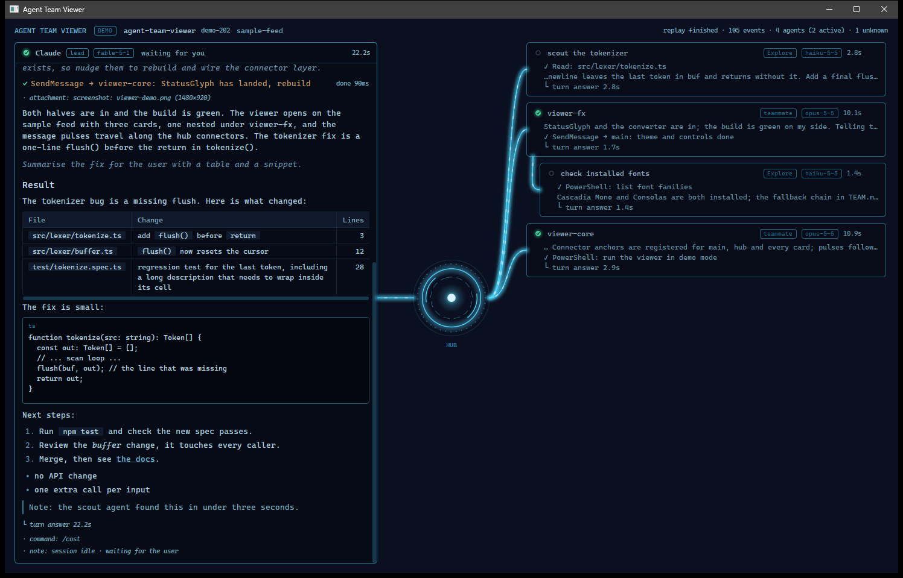

# Agent Team Viewer

Watch a Claude Code session's agent team live. The lead gets a full terminal
panel with its conversation and reasoning, each spawned agent gets a compact
card, and glowing connectors pulse when agents message each other.



## How it fits together

```
Claude Code session
  |- agent-feed mod  --writes-->  ~/.claude/agent-feed/<sessionId>/
  |                                 meta.json, 000001.jsonl, 000002.jsonl, ...
  |                                 control.jsonl  (dismiss requests, written by the apps)
  `- agent-team mod  --draws-->    a pane inside the terminal

apps/avalonia  --reads-->  the feed folder (and append dismiss requests)
```

- `mods/agent-feed` publishes everything the engine sees about the session's
  agents as numbered JSONL chunks, and carries out dismiss requests from the apps.
  It also ships the `/delegate-async` skill and a delegation section for the
  system prompt.
- `mods/agent-team` is an in-terminal pane showing the lead and every agent.
- `apps/avalonia` is the desktop viewer of the feed (Windows and macOS).
- The feed contract is in [docs/FEED.md](docs/FEED.md).

```
mods/agent-team/    in-terminal pane (plugin)
mods/agent-feed/    feed publisher, delegate-async skill (plugin)
apps/avalonia/      the desktop viewer (Avalonia, Windows and macOS)
docs/               FEED.md (feed contract); TEAM.md and PORT.md (historical design briefs)
```

## Requirements

- Claude Code with mod (function-hook plugin) support.
- .NET 9 SDK.
- Windows or macOS.

## Setup

1. Enable Agent Teams in `~/.claude/settings.json`:

   ```json
   {
     "env": {
       "CLAUDE_CODE_EXPERIMENTAL_AGENT_TEAMS": "1",
       "CLAUDE_CODE_SUBAGENT_MODEL": "claude-sonnet-5-5"
     }
   }
   ```

   `CLAUDE_CODE_SUBAGENT_MODEL` is optional; it sets the model teammates use.

2. Install the mods. From GitHub (this repository):

   ```
   /plugin install agent-feed --marketplace vtroharov/agent-team-viewer
   /plugin install agent-team --marketplace vtroharov/agent-team-viewer
   ```

   Or from a local clone:

   ```
   claude plugin marketplace add <path-to-clone>
   claude plugin install agent-feed@agent-team-viewer
   claude plugin install agent-team@agent-team-viewer
   ```

3. In a session that was already running, run `/reload-plugins`.

Every session now writes a feed under `~/.claude/agent-feed/`.

## Run the app

From `apps/avalonia`:

```
dotnet build AgentTeamViewer.Avalonia
dotnet run --project AgentTeamViewer.Avalonia                      # newest live session
dotnet run --project AgentTeamViewer.Avalonia -- --demo            # replay the bundled sample feed
dotnet run --project AgentTeamViewer.Avalonia -- --session <dir>   # a specific session directory
dotnet run --project AgentTeamViewer.Avalonia -- --root <dir>      # look for sessions elsewhere
dotnet run --project AgentTeamViewer.Avalonia -- --demo --rate 40  # replay faster
dotnet publish AgentTeamViewer.Avalonia -r osx-arm64 -c Release    # macOS build
```

The first run restores the Avalonia packages and takes about a minute. For an
exe to pin to the taskbar on Windows, build with `-c Release` and run
`AgentTeamViewer.Avalonia/bin/Release/net9.0/AgentTeamViewer.Avalonia.exe`.
The macOS build is compile-checked only. Card order is saved under
`LocalApplicationData/AgentTeamViewer.Avalonia/`.

## Features

- Lead panel with the conversation, thinking and tool calls.
- One card per agent, nested agents indented under their parent.
- Ready indicators, model chips and worked time on each card.
- Markdown rendering in assistant text and delivered messages: headings, tables,
  code blocks, inline code, lists and links.
- Click a card to expand it in place and read the agent's full log.
- Drag cards to reorder them; the order is remembered.
- Dismiss (X) on a card: the agent's summary is delivered to the lead and the
  agent is stopped.
- Session picker with names that follow renames, and session delete.
- Restart survival: the pane rebuilds from the feed, and a teammate is resumed
  by name-to-id lookup.
- The `/delegate-async` skill and a delegation section in the system prompt,
  both from `agent-feed`, which tell the lead to hand tasks to subagents and
  stay free for conversation.
- Selectable text in the lead panel and in an expanded agent's log, with copy.

### Copying text

| What you do | What gets copied |
|---|---|
| Drag across a paragraph, then Ctrl+C | The selected text |
| Drag inside a table cell, then Ctrl+C | The selected part of the cell |
| Right-click a reply, then "Copy block" | The whole reply as Markdown, so tables and code fences stay intact |
| Click the copy button on a code block | The code exactly, without the fences |
| Drag inside an expanded agent's log | The selected text; the card stays open |

Auto-scroll holds still while text is selected; click elsewhere in the log to
clear the selection and resume following. A plain click on a link opens it,
and a drag that starts on a link selects it. Selection works within one block
at a time; use "Copy block" for a whole message.

## Troubleshooting

- **Build fails because the exe is locked.** A running viewer holds
  `AgentTeamViewer.exe`. Close it, or build to another folder with `-o`.
- **An existing session shows nothing.** Run `/reload-plugins` in that session.
- **Teammates in tmux or iTerm panes (macOS) only report roster status.** Set
  `teammateMode` to `in-process` in your Claude Code settings.
- **Organisation-managed setups.** Plugin `prompt.compose` hooks are ignored
  there, so the delegation system-prompt section is not added.

## Developing the mods

```
claude plugin validate .
claude plugin validate mods/agent-feed
claude plugin validate mods/agent-team
claude plugin test mods/agent-feed
claude plugin test mods/agent-team
```
